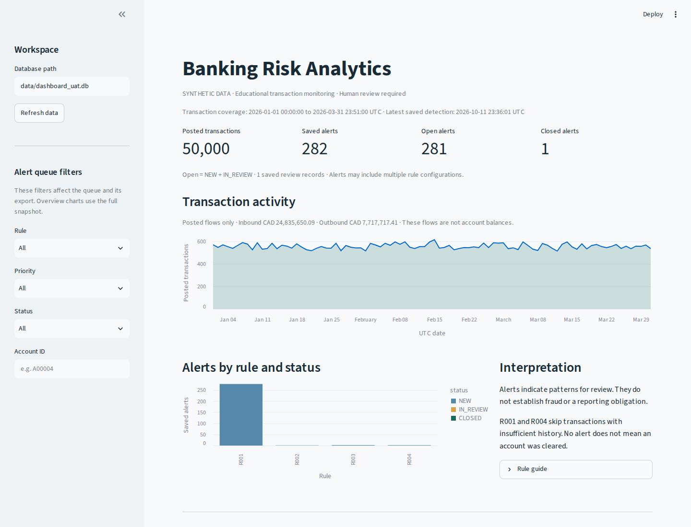

# Banking Risk Analytics — portfolio guide

**Yuzhan Gao · Independent, AI-assisted educational project · October 2026**

This project connects synthetic banking transactions, documented requirements,
explainable detection rules and a local analyst review workflow. It is a personal
portfolio project, developed with AI assistance, using entirely synthetic data.

## Start here

| Audience / purpose | Read |
| --- | --- |
| Recruiter or hiring manager: one-page project overview | [Case study](case_study.md) |
| Technical reviewer: modules, data flow and design choices | [Architecture](architecture.md) |
| Interview demonstration: prepare and present in five minutes | [Demo script](demo_script.md) |
| Interview preparation: explain the implementation and its limits | [Interview Q&A](interview_qa.md) |
| Application: concise project wording | [Resume project description](resume_project.md) |
| Business analysis: simulated workflows and acceptance criteria | [User stories](../user_stories.md) |
| Requirements evidence: code, tests and limitations | [Traceability matrix](../requirements_traceability.md) |
| Reproduction: environment and app startup | [Repository README](../../README.md) |

## Verified project evidence

- Seeded 50,000-transaction run: 300 customers, 450 accounts, four detection rules.
- 282 saved alerts on the all-scenario seed-42 snapshot; repeated runs add zero
  alerts on unchanged input/configuration. Alert counts are not accuracy metrics.
- 79 automated tests passed after installing the app dependencies.
- Real Streamlit browser screenshots, desktop/narrow layout checks, and persistent
  review save/reopen/fresh-session checks are documented in [UAT](../UAT.md).

The useful demonstration is the requirements-to-evidence path. Banking stakeholder
interviews, production deployment, real fraud outcomes and measured business savings
are outside the evidence in this repository. Practise the local demo and review the
modules before describing them in an interview.
