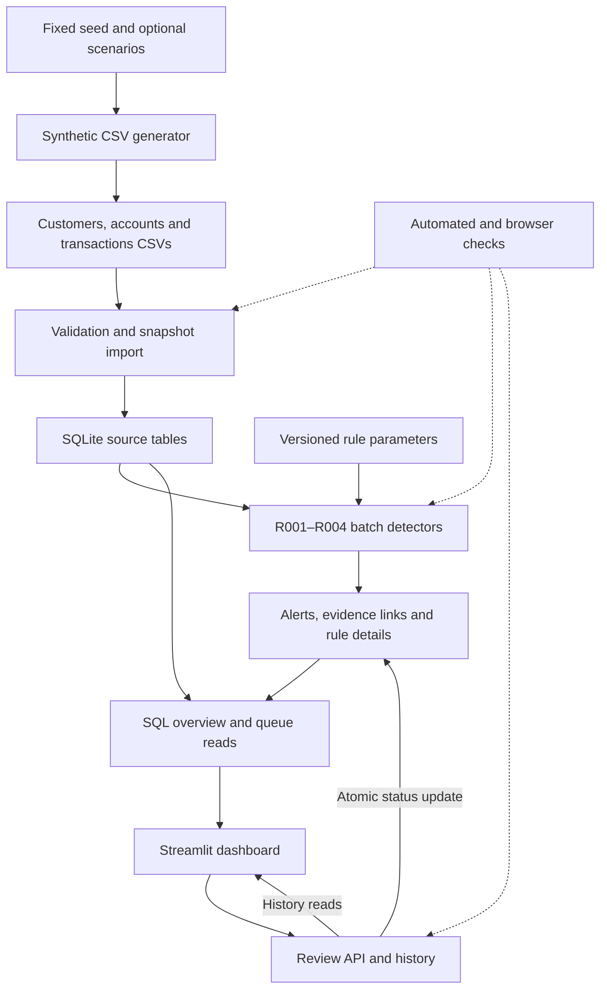

# Architecture and implementation decisions

The app is a local batch prototype. The source snapshot is treated as immutable
through supported workflows; alerts and review history are written separately.

## Data and control flow

Detection is invoked from the individual CLI or `run_demo.py` before launching
the dashboard. Opening or filtering the dashboard reads existing results; its
only business write is a submitted local review. All selected rule configurations
are validated before a multi-rule run starts, but each rule commits independently.

## Module map

| Responsibility | Files |
| --- | --- |
| Complete demo preparation, safe reuse and local server/browser startup | [run_demo.py](../../run_demo.py) |
| Synthetic generation and completed-file replacement | [generate_data.py](../../src/generate_data.py) |
| Shape, keys, dates, money and snapshot validation | [load_database.py](../../src/load_database.py) |
| Relational schema and SQL activity analysis | [schema.sql](../../sql/schema.sql), [analysis.sql](../../sql/analysis.sql) |
| Rule registry, selection and R002 rolling-window logic | [detect_risks.py](../../src/detect_risks.py) |
| R001/R003/R004 logic | [unusual amount](../../src/rule_unusual_amount.py), [rapid in/out](../../src/rule_rapid_in_out.py), [cross-border](../../src/rule_cross_border.py) |
| Deterministic alert identity and atomic evidence persistence | [risk_storage.py](../../src/risk_storage.py) |
| Overview, queue and page CSV export | [dashboard_data.py](../../src/dashboard_data.py) |
| Evidence/detail inspection | [show_alerts.py](../../src/show_alerts.py) |
| Review history, revision checks and status changes | [review_alerts.py](../../src/review_alerts.py) |
| UI and display formatting | [app.py](../../app.py) |

## Entity relationships

| Relationship | Cardinality / meaning |
| --- | --- |
| customers → accounts | One customer can have multiple accounts |
| accounts → transactions | One account can have multiple transactions |
| accounts → alerts | Alerts belong to a source account |
| alerts ↔ transactions | Many-to-many through alert_transactions; evidence may serve several rules/configurations |
| alerts → alert_details | Zero or one rule-detail record; earlier R002 alerts may have none |
| alerts → reviews | Multiple appended review records per alert |

SQLite foreign keys enforce linked IDs. Chronology and required CSV values are
validated by the importer. Evidence account consistency follows account-grouped
detector logic and checks; there is no composite SQL constraint enforcing that
an alert's account equals every linked transaction's account.

## Main design choices

| Choice | Why it fits this prototype | Trade-off |
| --- | --- | --- |
| Integer CAD cents | Exact storage and sums; integer comparisons support half-cent medians | No FX or multi-currency accounting |
| SQLite snapshot | One portable local database, transactional persistence | No production concurrency/scale claim |
| Configurable deterministic rules | Parameters and supporting transactions are visible | Thresholds require qualified calibration for real use |
| Prior-only historical baselines | Avoids future/current/same-time leakage | Sparse history is skipped |
| Hashed logical alert IDs | Same rule/version/parameters/account/evidence resolves to the same ID | Config changes coexist; source edits are unsupported |
| Evidence IDs joined to source | Clear drill-down into immutable input | Evidence is not separately frozen or tamper-proof |
| Append-only review API with revision guard | Earlier decisions remain visible; stale forms are rejected | Aliases are local labels, not authenticated users |
| Fresh dashboard reads on interaction | Review status stays current without cache invalidation | Not a real-time banking feed |
| Queue-only filters and bounded CSV | Scope and counts are explicit | Overview stays global; export contains the current page only |

## Transaction boundaries

- Input validation completes before opening the import database. Source inserts
  share one transaction; identical imports are no-ops, different snapshots are refused.
- Alert, evidence and rule details are saved together within the rule transaction.
- Review insert and alert status update share one transaction. The latest saved
  review ID is checked under the write lock before either write occurs.
- CSV replacement is atomic per completed file, not across the whole dataset.
- For a fresh launcher demo, generation, import and all four detectors complete
  in a temporary folder before the folder is renamed to its final destination.
  Existing launcher snapshots are validated/reused under a preparation lock;
  each detector still has its own transaction when reusing a snapshot.

The [data dictionary](../data_dictionary.md), [rule specs](../R001_rule_spec.md)
and [UAT record](../UAT.md) provide more detail. A production design would require
authenticated roles, controlled migrations, immutable evidence/audit controls,
representative data validation and an ingestion strategy beyond these local snapshots.
